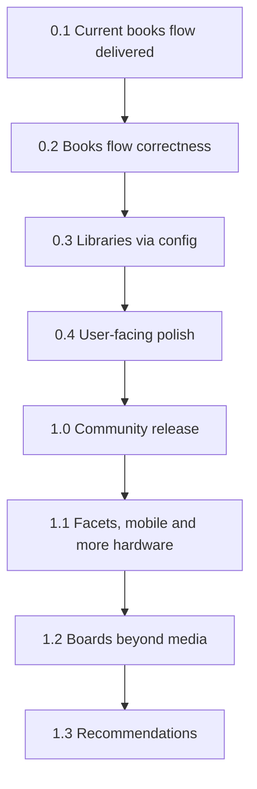

## road_001_stacks_to_1_0 - Stacks to 1.0
> Date: 2026-10-16
> Status: Proposed
> Related product: `prod_001_stacks_a_shelf_for_your_media_notes`
> Related request: `req_000_stacks_1_0_in_the_obsidian_community_plugin_directory`
> Reminder: Update status, milestone scope, linked refs, risks, and success signals when you edit this doc.
> Indicators reviewed: 2026-10-16 00:53:06

# AI Context
- Summary: Roadmap for Stacks from the working 0.1.0 books flow to a public 1.0 in the Obsidian community plugin directory, then post-1.0 depth.
- Keywords: roadmap, milestones, versions, stacks, obsidian plugin, community directory, 1.0, libraries, presets
- Use when: Planning or sequencing versions for Stacks.
- Skip when: You need execution details for a single backlog item; open the item instead.

# Summary
Owner decisions 2026-10-16 (see the product brief): headline "install, point at a folder, get a shelf and a board"; at least books, video games and films and series presets; desktop only for 1.0; shipped stages and device drawings are in 1.0; `view: now` in 0.4 and facets in 1.1 as planned; quick-add lookups on by default with disclosure. Ordering: correctness of the current books flow, then generalising libraries through config, then user-facing polish, then distribution. Today (0.1.0) the plugin works end to end for one vault whose layout is baked into the defaults; 1.0 means a stranger installs it from the directory and gets a working shelf and board from a preset. Scope freeze once accepted: new ideas go to 1.1 or later unless they block a 1.0 exit signal.

# Milestones
## 0.1 - Current books flow (delivered)
- Goal: A usable, config-driven media library engine on stable Obsidian APIs, proven on one real vault.
- Scope: Shelf, Board, List and Up next views; `stacks` code block embeds; live index over the metadata cache; writes through processFrontMatter; progress buttons; quick add from Open Library, Steam, Wikipedia, TVmaze and Kitsu; cover picker; undo toasts; search, sorting, cover size and remembered view state; ordered/loose series with ghost volumes and Buy next; Reading, Games and Watching libraries with stages per medium; 135 unit tests.
- Exit signal: Met: the owner uses it daily; `npm test` and `npm run build` pass.

## 0.2 - Books flow correctness
- `item_000_books_flow_correctness_pass`: Books flow correctness pass
- Goal: The existing flow is correct under real use before anything is generalised.
- Scope: External-edit propagation to views and embeds, loading state before the metadata cache resolves, a Rescan command, serialised writes per note with correct undo, graceful catalogue failures, regression tests for each fix.
- Exit signal: The four checks in item_000 (external edit, cold start, rapid clicks, offline add) pass and no known correctness bug is open.

## 0.3 - Libraries via config
- `item_001_neutral_defaults_and_library_presets`: Neutral defaults and library presets
- `item_002_self_contained_new_notes_and_catalogue_settings`: Self-contained new notes and catalogue settings
- Goal: Any vault can define its libraries from the settings tab; nothing about the owner's vault is hardcoded.
- Scope: Neutral defaults, presets (books, video games, films and series required for 1.0; comics and anime if cheap), folder, field and status mapping in settings, migration of saved settings, plain-Markdown new notes with an optional template, catalogue and region settings.
- Exit signal: In a fresh sample vault, a library added from each preset shows its notes on the shelf and board with no JSON editing, and new notes contain no Dataview block.

## 0.4 - User-facing polish
- `item_003_first_run_experience_empty_states_themes_and_mobile`: First-run experience, empty states, themes and mobile
- Goal: The first five minutes and the everyday look work for users other than the owner.
- Scope: First-run screen, empty states, light/dark and community theme pass, `isDesktopOnly: true` with the reason in the README (mobile is 1.1), shipped per-medium stages and device drawings checked in both themes, keyboard and label basics, 1,000-note performance check, generic `view: now` embed.
- Exit signal: A tester who has never seen Stacks reaches a working library in under five minutes on desktop, in light and dark themes.

## 1.0 - Community release
- `item_004_obsidian_plugin_guidelines_compliance`: Obsidian plugin guidelines compliance
- `item_005_public_readme_with_screenshots_install_and_configure`: Public README with screenshots, install and configure
- `item_006_github_release_workflow_and_versions_json`: GitHub release workflow and versions.json
- `item_007_community_directory_submission`: Community directory submission
- Goal: Stacks is listed in the Obsidian community plugin directory.
- Scope: Guidelines compliance (official ESLint plugin, manifest wording, UI text, network disclosure for quick-add lookups, which are on by default); a user-facing README (what, screenshots, install, configure) with no reference to the private vault; a GitHub Actions release workflow publishing main.js, manifest.json and styles.css on a version tag; versions.json kept in sync; CI on pull requests; the submission PR to obsidianmd/obsidian-releases.
- Exit signal: The PR to obsidianmd/obsidian-releases is merged and Stacks installs from the in-app community plugin browser.

## 1.1 - Faceted filters, mobile and more hardware
- Goal: Find and browse large libraries faster, run on phones and tablets, and show more platforms.
- Scope: Mobile support (touch drag, toolbar layout, `isDesktopOnly: false`); remaining presets (comics, anime) if not shipped in 1.0; Faceted filters (category, genre, franchise or setting, tags, platform), combinable and remembered per tab; more consoles and case styles picked by `platform` with defaults.
- Exit signal: Any two-facet filter is two clicks, shelf and board work on Obsidian mobile, and a library with an unknown platform still renders with a sensible default.

## 1.2 - Boards beyond media
- Goal: Use the same engine for any note with a status: projects, hobbies, reading lists of articles.
- Scope: A generic preset with configurable card fields, no covers required, and board-first layout.
- Exit signal: A project board built only from settings replaces a hand-written kanban in a test vault.

## 1.3 - Recommendations
- Goal: Suggest additions to the wishlist from what the user already rated well.
- Scope: Research spike on reliable free sources per medium first; suggestions are always reviewed by hand, never added automatically.
- Exit signal: The spike is written up and at least one medium gives suggestions the owner accepts more often than not.

# Sequencing
- Deliver milestones in ascending version order unless dependencies force a documented exception.
- 0.2 gates everything: no generalisation on top of known correctness bugs.
- item_005 screenshots wait for 0.4 so they show the final look; the release workflow (item_006) can land any time before 1.0.
- Keep each increment independently reviewable, covered by unit tests for pure logic, and linked to concrete workflow docs.

# Risks
- Polish churn: much of the 0.1 history is look-and-feel iteration; polish waits for 0.4.
- Presets may not fit how other people structure notes; field and status mapping must cover the common shapes, not every one.
- Free catalogues change or rate-limit without notice; quick add must degrade to manual entry.
- Mobile support may cost more than expected given the custom shelf styling; it is out of 1.0 by decision and scoped in 1.1.
- Directory review can take weeks; version labels are planning targets, not release promises.

# References
- Product brief(s): `prod_001_stacks_a_shelf_for_your_media_notes`
- Request(s): `req_000_stacks_1_0_in_the_obsidian_community_plugin_directory`
- Backlog item(s): see milestones
- Task(s): (none yet)
